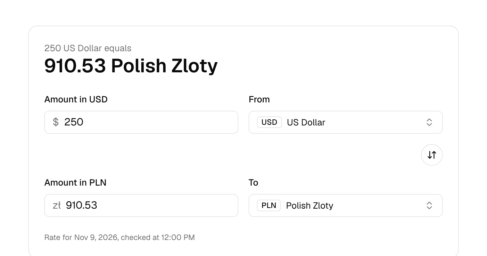
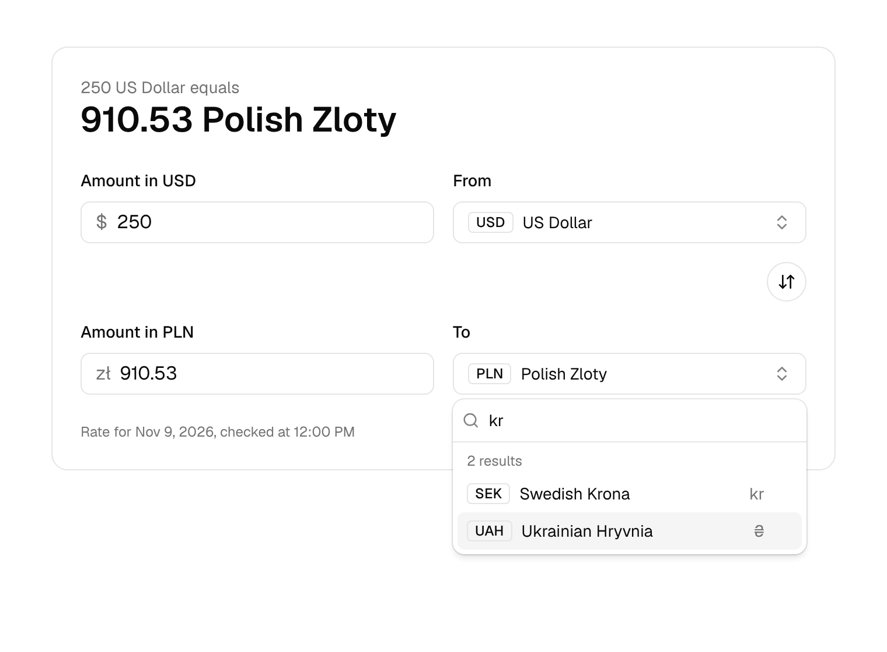

# Currency Converter

[](https://github.com/dianaasamkova/currency-converter-app/actions/workflows/ci.yml)

A fast, accessible currency converter in the style of Google's, with 161 fiat currencies from the [CurrencyBeacon API](https://currencybeacon.com/). You can type in either field, search currencies by name or code, and share the result as a link.



<sub>Screenshots use stubbed API data.</sub>

## Highlights

- **The API key never reaches the browser.** A same-origin proxy adds it on the server: Vite's proxy in dev, a Vercel Function in production. The key has no `VITE_` prefix, so it can't leak into the bundle.
- **No stale results.** A new currency pair aborts the previous request, and each rate is stored with its pair, so a result is never shown next to currencies it wasn't calculated for.
- **No request per keystroke.** One request per currency pair loads the rate; typing converts locally, instantly.
- **Both fields editable.** The last edited field is the source; the other is calculated.
- **State in the URL.** Reloading or sharing `?amount=250&from=USD&to=PLN` keeps the inputs.
- **Accessible (WCAG 2.2 AA target):**
  - an ARIA combobox with ↑/↓/Enter/Esc
  - labelled fields
  - results announced through `aria-live`
- **Locale-aware.** `Intl.DisplayNames` gives full currency names ("Polish Zloty", not "Zloty"); `Intl.NumberFormat` applies each currency's precision.
- **Lean.** No state, fetching or validation libraries: typed hooks and the platform cover it.



## Tech stack

React 19 · TypeScript (strict) · Vite · Tailwind CSS v4 · shadcn/ui (Radix Popover) · Vitest · oxlint · Vercel Functions · Docker

## Run locally

1. Get a free API key at <https://currencybeacon.com/register>.
2. Create your env file and put the key in it:
   ```bash
   cp .env.example .env.local
   ```
3. Start with Docker:
   ```bash
   docker compose up --build
   ```
   Or with Node 20.19+:
   ```bash
   npm install && npm run dev
   ```
4. Open <http://localhost:5173>.

| Script | What it does |
|---|---|
| `npm run dev` | Dev server with the API proxy |
| `npm test` | Unit tests (Vitest) |
| `npm run lint` | oxlint |
| `npm run build` | Type-check and production build |

The key is read from `CURRENCYBEACON_API_KEY` (no `VITE_` prefix), so it never ends up in the client bundle or in git (`.env.local` is ignored). Tests and builds don't need a key.

## Deploy

Import the repo on Vercel and set `CURRENCYBEACON_API_KEY`. `api/[endpoint].ts` becomes the production proxy.

## Docs

- [docs/REQUIREMENTS.md](docs/REQUIREMENTS.md): scope, user and technical acceptance criteria.
- [docs/TECHNICAL.md](docs/TECHNICAL.md): architecture, the API contract, key decisions, testing, known gaps and the roadmap.
