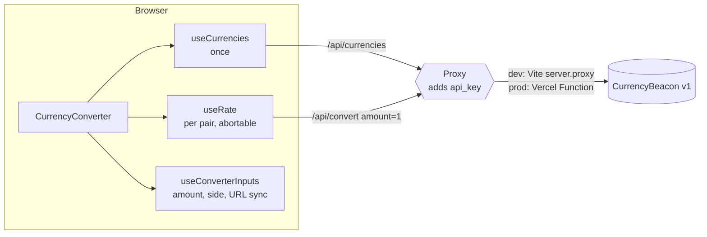

# Currency Converter: Technical Spec

**What:** single-page converter in the style of Google's. Requirements: [REQUIREMENTS.md](REQUIREMENTS.md).
**Stack:** React 19, TypeScript (strict), Vite, Tailwind CSS v4, shadcn/ui (`Popover` only), oxlint.

## 1. Architecture

- The browser calls same-origin `/api/currencies` and `/api/convert`.
- A proxy forwards them to CurrencyBeacon and adds the API key: Vite `server.proxy` in dev, a Vercel Function (`api/[endpoint].ts`) in prod.
- **Why a proxy:** the API has no CORS, so a browser can't call it directly. It also keeps the key on the server.
- **Key safety:** `CURRENCYBEACON_API_KEY` has no `VITE_` prefix (never in the bundle), and `.env.local` is git-ignored.
- The proxy only forwards `currencies` and `convert`.

## 2. Code structure

- `src/api.ts`: API types and calls; turns API errors into `Error`.
- `src/hooks/useCurrencies.ts`: loads the currency list once.
- `src/hooks/useConverterInputs.ts`: amount, the side it was typed in, currencies, input rules, URL sync.
- `src/hooks/useRate.ts`: abortable rate loading per currency pair; local conversion.
- `src/components/`: UI (converter, currency select, fields, result, error).
- `src/lib/format.ts`: number and date formatting.

## 3. Key decisions

- **No extra libraries** for state, fetching or validation: plain hooks are enough.
- **Rate-based conversion:** one request per currency pair (`amount=1`); typing converts locally, so no request per keystroke.
- **The rate is stored with its pair:** a value is never shown next to the wrong currencies.
- **Full currency names** from the browser (`Intl.DisplayNames`): the API only gives short ones ("Zloty").
- **Inputs in the URL:** a reload or a shared link keeps them.
- **Same currency on both sides - swap:** from and to are always different.
- **Either field is editable:** the last edited one is the source, the other is converted.

## 4. API notes

- `GET /currencies?type=fiat` (161 currencies) and `GET /convert?from&to&amount`.
- An unknown code or bad amount returns HTTP 200 with `value: 0`, not an error. Codes come only from the list and the amount is validated, so this can't happen.
- On error the UI shows the API's message (or "Network error") with Retry.

## 5. Testing

- **Unit tests (Vitest):** `applyRate` in both directions; money formatting (precision, grouping, no grouping in inputs); rate dates stay on the API's day in any time zone.
- **CI:** GitHub Actions runs lint, tests and a production build on every push and pull request. No API key is needed.
- **Next:** hook tests for `useRate` (abort and stale-pair handling) with Testing Library, and a Playwright smoke test with the API stubbed.

## 6. Known gaps

- Amount limits (15 digits, decimals per currency)
- Pasting `$1,234.56`
- Symbol after the number (`100 zł`)
- Rate line `1 USD = 3.88 PLN`
- Hook and end-to-end tests (see Testing)

## 7. Roadmap

Ordered by user value against effort:

1. **Deploy** to Vercel and put the live URL at the top of the README.
2. **Input polish:** paste `$1,234.56`, limit decimals to the currency's precision, and place the symbol after the number where the locale does.
3. **Rate line** `1 USD = 3.6421 PLN` and the inverse, so users can sanity-check.
4. **Faster pickers:** a "Popular" group and recently used currencies at the top (stored locally).
5. **Caching:** `Cache-Control: s-maxage` on `/api/currencies` at the edge, and an in-memory rate cache per pair with a short TTL.
6. **Rate history:** a 30-day sparkline for the pair from the `timeseries` endpoint.
7. **Offline and PWA:** the last known rates with a clear "as of" label when offline.

## 8. Run and deploy

- Local: `cp .env.example .env.local` (add the key), then `npm install && npm run dev`.
- Tests: `npm test` (no key needed).
- Deploy: import the repo on Vercel and set `CURRENCYBEACON_API_KEY`.
